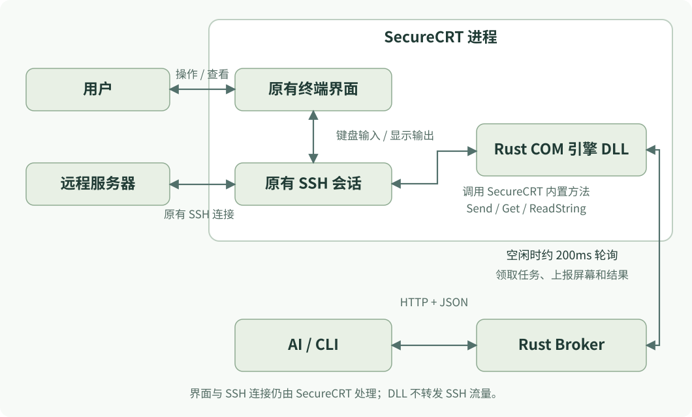
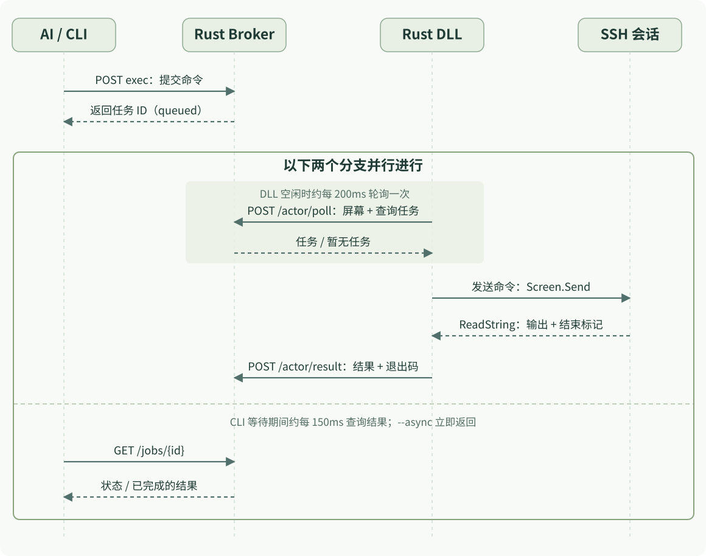

平常连接服务器时，我会先在堡垒机页面点击 SSH，由本地客户端打开 SecureCRT，完成登录。这个流程已经能用，也保留了现有的认证和审计机制。

但和 AI 一起排查问题时，还要不停地复制命令、切到终端执行，再把结果贴回来。于是有了一个很直接的想法：**继续用原来的 SecureCRT，让 AI 也能操作我已经打开的那一个标签页。**

这个小工具叫 **SecureCRT Bridge**。源码、构建方法和安装包放在 [GitHub 仓库](https://github.com/LinHuiG/securecrt-bridge)。

## 它用起来是什么样

安装后，仍然按原来的方式连接 SSH。新会话通过登录钩子自动接入本地桥接。AI 可以列出会话、读屏幕、执行命令，并获取输出和退出码；这些操作也会出现在我的终端窗口中。

窗口不需要保持前台，最小化也可以。多个标签页各自拥有独立的会话 ID，不同会话能并行执行任务。同一个标签页的 AI 写入则通过租约和任务状态串行处理。

安装器是原生 Windows 窗口，可以自动查找 SecureCRT，也能手动选目录。安装、升级、卸载共用一个入口，执行时显示进度条和具体步骤。日志会给出程序、skill、配置及备份的完整路径。

交付物是一个带内嵌 DLL 的 EXE。用户不需要安装 Rust、Python 或 Node；需要自己已有 Windows x64 和 SecureCRT x64 环境。

## 为什么选择接入现有会话

另一种办法是让 AI 直接启动自己的 SSH 客户端。但在堡垒机工作流里，连接可能依赖现有客户端交接的登录信息、临时会话或认证步骤。重复实现这条链路会增加维护成本，也改变了原来的操作方式。

桥接的边界很明确：连接和认证仍交给 SecureCRT 与堡垒机；桥接只操作已经获得授权的终端。它不提取远程密码，不建立第二条 SSH 连接，也不绕过认证。

这里依赖的是 SecureCRT 提供的脚本接口。Windows 上支持 ActiveX 脚本语言，脚本能访问终端对象；官方也提供了用 `ReadString()` 采集命令输出的示例。参见 [Scripting FAQ](https://www.vandyke.com/support/securecrt/scripting_faq.html) 和 [ReadString 示例](https://www.vandyke.com/support/tips/readstring.html)。

## 实现：后台调度与进程内调用

运行时有两个主要组件：独立运行的 **Rust Broker**，以及加载在 SecureCRT 进程里的 **Rust COM 引擎 DLL**。AI 通过 CLI 或 HTTP 找到 Broker，DLL 主动向 Broker 领取任务，再调用 SecureCRT 内置的终端读写方法。



图中的 DLL 是从旁边接入终端的控制分支。用户原来的界面、键盘输入和 SSH 连接都由 SecureCRT 处理，DLL 不承担终端绘制或 SSH 流量转发。

### Broker：保存状态和调度任务

Broker 由 `securecrt-bridge.exe serve` 启动，维护会话列表、最近一次屏幕快照、写入租约、任务状态和执行结果。它是普通的用户进程，通过当前用户的 Windows 启动项自动运行。

AI 提交命令后，Broker 先记录任务；对应 DLL 实例下一次轮询时，Broker 才在 HTTP 响应中返回任务。不同会话独立处理，同一会话的 AI 写入由租约和忙碌状态协调。

### DLL：直接调用 SecureCRT 的内置方法

DLL 使用 Rust 实现 `IActiveScript` 和 `IActiveScriptParse64`，以 `SecureCRTBridge.Native` 注册为当前用户的 COM 脚本引擎。SecureCRT 登录钩子加载它，宿主通过 `IActiveScriptSite` 提供 `crt` 对象，DLL 再通过 `IDispatch` 调用终端方法。

这里的“脚本 API”指 SecureCRT 自带的方法，并没有在 DLL 与终端之间再运行一层 VBScript 或 Python：

| SecureCRT 方法 | DLL 用它做什么 |
|---|---|
| `Screen.Get(...)` | 读取当前可见屏幕的文字，生成快照 |
| `Screen.Send(...)` | 向会话发送命令或原始输入 |
| `Screen.ReadString(...)` | 读取终端输出，等待指定标记 |

这些调用发生在 SecureCRT 的宿主脚本线程中。方法调用属于进程内接口；传入的命令字符串和返回的终端文字，才是通过接口交换的数据。

### 本地端口：HTTP/1.1 + JSON

Broker 只监听 `127.0.0.1`，从 `18765` 到 `18799` 中选择一个可用端口。通信使用 TCP 上的 HTTP/1.1，请求和响应中的业务数据使用 UTF-8 JSON。

所有接口通过 `Authorization: Bearer <token>` 认证。本机发现文件保存端口和令牌，CLI 自动读取它：

```text
%USERPROFILE%\AppData\Local\SecureCRTBridge\connection.json
```

本地 HTTP 这一段不使用 TLS；远程连接的 SSH 加密和认证继续由 SecureCRT 负责。这个端口提供的是终端操作接口，不能把它当作 SSH 端口直接连接。

## 一条命令的数据流程

登录接入后，DLL 会持续向 Broker 上报会话信息。AI 先列出会话、读取屏幕，再为目标会话申请写入租约。下面从命令提交开始，展示两个并行发生的轮询过程：



**任务由 DLL 主动领取。** Broker 不会主动连接 SecureCRT，也不在 HTTP 请求到达时直接操作终端。DLL 空闲循环每次结束后等待约 200 毫秒，实际间隔还包含屏幕读取和请求耗时；执行命令期间会等待终端输出，完成后回传结果，再恢复轮询。

**CLI 负责等待结果。** 默认的 `exec` 会先提交任务，再约每 150 毫秒查询一次状态，因此使用者看到的是一次完整的命令调用。加上 `--async` 后，CLI 在提交成功后立即返回，调用方可以稍后自行查询。

数据沿途有三个主要标识：

| 字段 | 含义 |
|---|---|
| `session` / 路径中的会话 ID | 要操作的 SSH 会话；DLL 上报时对应字段为 `id` |
| `owner` | 当前 AI 对话或调用方的租约标识 |
| `request_id` | 一次命令请求的标识，用于领取任务和查询结果 |

屏幕快照和命令结果也有区别。`screen` 返回 Broker 最近收到的可见屏幕文字，并带有 `last_seen` 时间；它不是实时截图或完整滚屏历史。命令结果则由 DLL 在本次执行期间采集，包含 `output` 和 `exit_code`。终端中的标准输出与错误输出合在同一条文本流中。

### 从连续终端输出中划分命令结果

终端是连续字符流，没有天然的“这段就是某条命令的响应”。当前实现针对 POSIX shell，把命令包在两个随机标记之间：

```sh
(
  printf '\n%s\n' '__SCB_''request_BEGIN__'
  sh -c 'hostname; pwd'
  rc=$?
  printf '\n%s:%s\n' '__SCB_''request_END__' "$rc"
)
```

实际请求 ID 每次生成。发送给终端的标记被拆成相邻的引号字符串，而 shell 输出时会拼成完整标记。这样 `ReadString()` 就不会把终端对输入命令的回显误认成真正的开始或结束。

采集器等待开始标记，读取到结束标记，再解析退出码。命令在子 shell 中执行，因此 `cd` 或环境变量赋值不会改变用户父 shell 的上下文。需要目录上下文时，应一次提交 `cd /path && command`。

这种协议适用于空闲的 POSIX shell，不适用于密码提示、编辑器、数据库客户端或任意全屏交互程序。需要交互时可以发送原始输入，但不能沿用 shell 命令的结束判断。

## 主要 HTTP 接口

下面的 `{id}` 表示会话 ID，`{request_id}` 表示命令请求 ID。所有请求都需要携带本机 Bearer 令牌，POST 的业务参数放在 JSON 请求体中。

| 方法与路径 | 用途 | 主要参数或返回内容 |
|---|---|---|
| `GET /health` | 检查服务 | 版本、暂停状态 |
| `GET /sessions` | 列出会话 | ID、标题、连接状态、租约和忙碌状态 |
| `GET /sessions/{id}/screen` | 读取最近的屏幕快照 | 屏幕文字、上报时间 |
| `POST /sessions/{id}/claim` | 申请或续期写入租约 | `owner`、可选的 `ttl_seconds` |
| `POST /sessions/{id}/exec` | 提交 shell 命令 | `owner`、`request_id`、`command`、`timeout_seconds` |
| `POST /sessions/{id}/input` | 发送原始输入 | `owner`、`request_id`、`text` |
| `POST /sessions/{id}/interrupt` | 对自己的未知任务发送一次 Ctrl+C（0.1.6） | `owner`、`request_id`、原任务的 `job_id` |
| `GET /jobs/{request_id}` | 查询任务 | 状态、输出、退出码、执行时间 |
| `POST /sessions/{id}/release` | 释放租约 | `owner` |
| `POST /sessions/{id}/acknowledge` | 确认终端恢复空闲后解除任务占用 | `owner` |
| `POST /sessions/{id}/pause` | 暂停或恢复一个会话 | `paused` |
| `POST /pause` | 暂停或恢复全局任务派发 | `paused` |

DLL 使用另外两个内部接口：`POST /actor/poll` 上报会话 ID、标题、连接状态和屏幕文字，并在响应中领取任务；`POST /actor/result` 提交任务 ID、会话 ID 和结果。这两个接口由引擎使用，AI 通常无需直接调用。

0.1.6 的 `interrupt` 用于恢复自己的未完成输入，例如引号未闭合导致 shell 停在 `>`。它通过现有轮询发送一次 Ctrl+C，保留原任务锁；AI 查询新的屏幕快照、确认普通提示符后，再调用 `acknowledge`。它不抢占正在进行的输出采集，也不会自动重跑原命令。

例如，申请租约后向 `POST /sessions/{id}/exec` 提交：

```json
{
  "owner": "demo-chat",
  "request_id": "demo-command-001",
  "command": "hostname; pwd",
  "timeout_seconds": 30
}
```

提交响应只说明任务已入队：

```json
{"ok": true, "id": "demo-command-001", "status": "queued"}
```

随后查询 `GET /jobs/demo-command-001`。正常执行完成后的关键字段如下，服务器名和路径使用示例值：

```json
{
  "ok": true,
  "id": "demo-command-001",
  "status": "done",
  "result": {
    "ok": true,
    "outcome": "completed",
    "output": "demo-server\r\n/home/demo\r\n",
    "exit_code": 0
  }
}
```

## 源码结构与各模块职责

项目采用 Cargo workspace，分成 `core`、`engine`、`app` 三个 crate：公共通信与状态逻辑放在 `core`，SecureCRT 进程内的接入逻辑放在 `engine`，安装和使用入口放在 `app`。

```text
SecureCRTBridge/
├─ crates/
│  ├─ core/src/
│  │  ├─ broker.rs       会话、租约、任务状态、请求去重、HTTP 路由
│  │  ├─ http.rs         HTTP 报文读取、响应生成、本地请求客户端
│  │  ├─ config.rs       配置编码处理、修改记录、备份和恢复
│  │  └─ lib.rs          公共结构、路径、JSON 存储、命令标记包装
│  ├─ engine/src/
│  │  ├─ lib.rs          COM 引擎入口、生命周期、登录钩子处理
│  │  ├─ dispatch.rs     封装 IDispatch 的方法调用与属性访问
│  │  ├─ terminal.rs     读屏、轮询、发送命令、采集并回传结果
│  │  └─ probe.rs        SecureCRT 进程内的诊断探针
│  └─ app/
│     ├─ src/
│     │  ├─ main.rs          CLI 入口、命令分发、Broker 启动
│     │  ├─ installer_ui.rs  安装窗口、路径选择、进度和日志
│     │  ├─ installer.rs     路径检测、安装卸载、注册和配置修改
│     │  ├─ platform.rs      Windows 注册表、权限、进程等操作
│     │  ├─ tray.rs          系统托盘与暂停、恢复、退出控制
│     │  └─ diagnose.rs      使用隔离配置运行诊断的独立程序
│     └─ build.rs            嵌入引擎 DLL 和 Windows 清单
├─ assets/skill/SKILL.md     AI 使用桥接的操作说明
├─ build.ps1                开发时的测试、构建与打包入口
└─ docs/VALIDATION.md        验证记录
```

顺着一次 `exec` 看代码，可以从 `app/main.rs` 入手：解析参数后，通过 `core/http.rs` 发起请求；`core/broker.rs` 保存任务，等待 `engine/terminal.rs` 轮询领取。终端执行时，`terminal.rs` 使用 `core/lib.rs` 生成标记，再通过 `engine/dispatch.rs` 调用 SecureCRT。执行结果回到 Broker 后，`main.rs` 的查询循环读取并输出 JSON。

配置修改与运行时操作分别位于 `config.rs` 和 `terminal.rs`。这样安装器可以独立处理配置备份与恢复，终端引擎则专注于已连接会话的读写。

## 安装、自动启动与打包

安装界面使用 Win32 原生控件，路径选择、进度条和逐步日志都由 Rust 代码处理。耗时操作放在工作线程，界面通过进度事件更新。

安装过程依次检测 SecureCRT 及其配置目录，将程序写入所选目录下的 `SecureCRTBridge` 子目录，注册当前用户的 COM 引擎，备份并设置登录钩子，然后配置启动项和 skill。Windows 登录后可以自动启动 Broker，新 SSH 会话通过登录钩子加载 DLL，必要时启动 Broker。

安装记录保存配置的修改前后值，以及自有文件的哈希。卸载时仍保持安装值的配置会恢复原值，用户之后改过的配置和文件则保留并提示。

实现主要使用 Rust 标准库的 TCP、线程和同步机制，`serde` / `serde_json` 处理 JSON，`windows` / `windows-core` 提供 Win32 与 COM 绑定，`uuid` 生成标识，`sha2` 计算文件哈希。

构建时先生成 `scb_engine.dll`，再通过 `include_bytes!` 把它嵌入安装 EXE，同时带上 skill、说明和许可证。安装后运行的是 EXE 与 DLL，分发时只需提供一个安装包。`build.ps1` 只用于开发阶段调用 Cargo，用户运行时不依赖它。

## 让其他 AI 对话接入

0.1.7 的安装窗口提供“安装 AI Skill”总开关和客户端复选框列表。检测到的本机 Agent 默认勾选，支持 Codex、DeepSeek Harness、Claude Code、Cursor、GitHub Copilot、Gemini CLI 和 OpenCode；也可以取消全部，或为其他客户端添加多个自定义目录。

检测只检查客户端配置目录、支持的环境变量和 PATH 入口，不启动 Agent。列表和安装日志显示完整的 `SKILL.md` 路径，选中一行后可以修改目录。以 DeepSeek Harness 为例，默认使用 `$DSH_HOME/skills/securecrt-bridge/SKILL.md`，未设置时使用 `~/.dsh/skills/securecrt-bridge/SKILL.md`。

skill 使用标准的 `name`、`description` 和 Markdown 正文，说明如何发现安装路径、列出会话、读屏幕、申请租约及释放。它不保存服务器密码或本机令牌，也不授予新的系统权限。各客户端仍需启用本地 Skill 加载和命令工具；完整目录表与兼容边界见仓库的 [客户端目录说明](https://github.com/LinHuiG/securecrt-bridge/blob/main/docs/AGENT_SKILLS.md)。

安装记录保存所有实际目标目录。升级取消勾选某个客户端时，只移除未被用户修改的旧 Skill；修改过的内容会保留。卸载也按这些记录处理，不删除客户端或其他 Skill。

读取会话、屏幕和既有结果，可以在 AI 客户端中为固定的只读子命令配置长期允许规则；远程写入按具体操作、目标和已授权范围处理。同一任务内的同类操作可以复用已有授权，但 `exec` 本身能执行任意 shell 命令，不能整体当成只读接口放行。桥接的会话租约与客户端的工具审批分别生效，配置方法见仓库的 [审批说明](https://github.com/LinHuiG/securecrt-bridge/blob/main/docs/APPROVALS.md)。

手动使用 CLI 的流程类似：

```powershell
& $scb sessions | Out-String
& $scb screen SESSION_ID | Out-String
& $scb claim SESSION_ID --owner my-task | Out-String
& $scb exec SESSION_ID --owner my-task --command 'hostname; pwd' | Out-String
& $scb release SESSION_ID --owner my-task | Out-String
```

`$scb` 指向安装后的 `securecrt-bridge.exe`，完整发现方式见仓库 README。

## 验证范围与当前限制

自动测试覆盖通信、租约和任务调度、配置恢复、COM 生命周期及终端结果采集。在 SecureCRT 9.7.1 的真实测试中，两个最小化的 SSH 标签页能够并行执行命令并返回完整输出。具体通过项目和未覆盖项见仓库的 [验证记录](https://github.com/LinHuiG/securecrt-bridge/blob/main/docs/VALIDATION.md)。

当前只支持 Windows x64 与 SecureCRT x64，命令采集面向 POSIX shell。已有内置 Python 登录脚本会保留并跳过；第三方 ActiveX 脚本串联仍需更多兼容验证。显式 `/SCRIPT` 参数也可能覆盖默认登录钩子。

本机服务只绑定 `127.0.0.1`，接口要求令牌并拒绝带 Origin 的浏览器请求，但同一 Windows 用户下的恶意程序仍属于信任边界之内。连接发现文件不要上传到仓库。项目采用 MIT 许可，不包含 SecureCRT 本体或堡垒机客户端。
