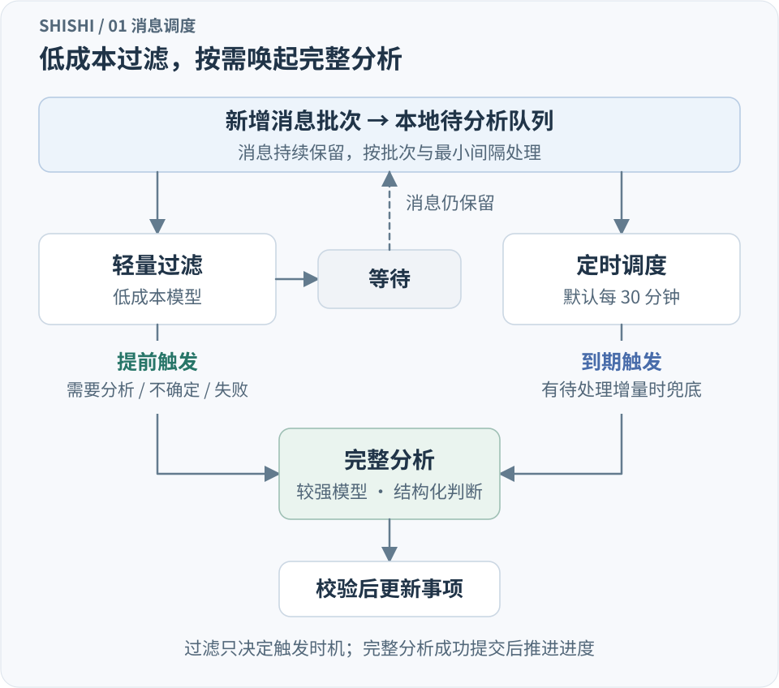
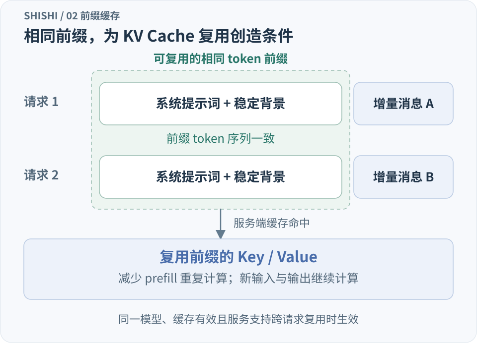
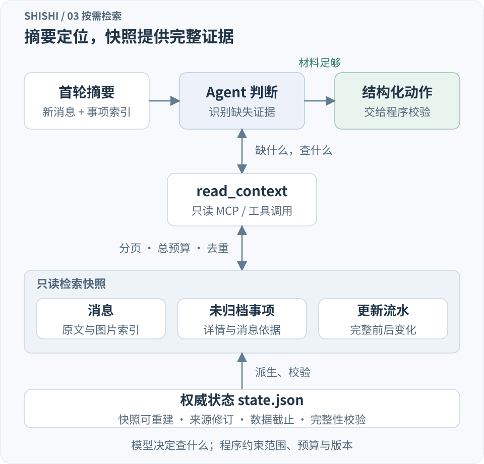
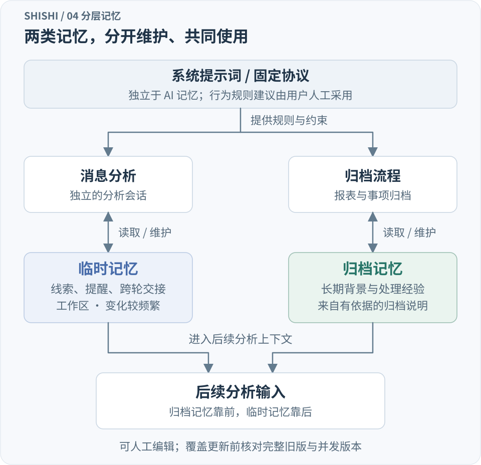

工作中的很多事项，最初都只是一条聊天消息。

有人报告了一个问题，另一个人补充了截图，过一会儿又有人说正在处理，最后处理结论散落在后续讨论里。想知道这件事现在是什么状态、还缺什么、下一步该做什么，往往需要重新翻一遍聊天记录。

我做拾事（ShiShi），就是希望把这段工作交给 AI：从消息中发现事项，持续更新状态，保留判断依据，在需要时由用户发起调查和处置，再把有用的经验留给后续分析。

拾事是一款 Windows 桌面应用，核心使用 Rust，负责状态管理、文件读写、后台调度、子进程和 AI 协议接入。窗口由 tao 管理，wry / WebView2 展示本地 HTML、CSS 和 JavaScript 界面，前后端通过 IPC 交换结构化数据，无需另外部署常驻 Web 后端。

业务状态和检索快照使用本地 JSON、JSONL 文件，借助 serde / serde_json 序列化。消息来源通过 DLL 插件扩展，以 C ABI 交换 JSON；AI 接入则分别适配 Codex CLI、DSH 的 ACP 协议和 Chat Completions 兼容 API。应用负责组织上下文和校验结果，接入层负责各后端的协议差异。

最早的框架已经包含了增量分析、事项摘要、按需补查和持续处置。后面的迭代，主要围绕几个问题展开：怎样减少不必要的模型调用，怎样让每次输入更小，怎样复用相同前缀，以及怎样在独立会话之间保留连续性。

这篇文章就沿着一次新消息进入系统后的路径，介绍这些设计。

**先用低成本模型判断是否需要提前分析。** 如果每来一条新消息，都让能力较强的模型重新整理事项，调用频率和上下文开销会很快增加。聊天中的很多内容只是确认、补充或一般交流，并不需要立即更新事项。

但如果完全依赖较长的定时周期，重要消息又可能等太久。我的做法是在完整分析之前加一层轻量过滤：完整分析默认每半小时进行一次，作为有待处理增量时的常规兜底；新消息到来后，先交给低成本模型，判断是否值得提前启动完整分析。

过滤模型只需要给出一个很小的决策：等待、提前分析，或者不确定。等待时，消息继续留在待分析队列；需要分析或不确定时，系统提前唤起分析模型。过滤调用失败，也会走回完整分析的路径。

实际实现按新增消息批次处理，并设置最小调用间隔，合并密集到达的消息，避免每条消息都形成一次请求。过滤与完整分析可以分别配置模型，让轻量模型承担高频判断，让能力较强的模型集中处理真正需要整理的材料。

这里有一个关键边界：过滤只决定什么时候分析。它不会删除消息，也不会把消息标记为已经完成分析。即使过滤判断为等待，定时分析仍会处理积累的有效增量。

这样，普通消息可以合并处理，值得关注的变化可以提前进入完整分析，在控制调用成本的同时缩短事项更新延迟。它的收益取决于消息量、过滤成本和提前触发比例，不能只用减少了多少次完整分析来计算；过滤本身的用量也需要单独记录。



**接下来，要准确判断什么才算新内容。** 消息来源通常会被反复扫描，同一条消息也可能被编辑、撤回，或者只是显示名称发生变化。要做好增量处理，需要区分消息身份和消息内容版本。

拾事用稳定 ID 区分不同消息，用内容指纹判断同一条消息有没有发生实质变化。当前参与变化判断的是正文和撤回状态。来源名称、群名、发送者显示名称或本地缓存路径发生变化，不应该让原本已经分析过的消息重新排队。

这里的“指纹”是内容的规范表示，职责是比较版本，并不要求它一定是某种哈希。更值得关心的是比较范围：哪些字段变化确实可能影响 AI 的判断，哪些只是展示元数据。

仅有内容指纹还不够。旧消息被编辑时，原始发送时间可能没有变化，所以处理进度使用一个以毫秒时间为基准、严格递增的本地版本值。每次写入新增或内容发生变化的消息时，按下面的规则分配：

```text
本次版本值 = max(当前毫秒时间, 上一次版本值 + 1)
```

假设三条消息依次写入时，系统时钟都还是 1000，分配的版本值可以是 1000、1001、1002。这里记录的是程序写入状态的顺序，不代表消息在外部系统中的真实到达先后；消息原始发送时间仍单独保留。已有消息只有显示字段变化时，版本值保持不变。

过滤和完整分析分别维护自己的进度。游标记录已经确认到的版本位置，另外用一张按消息 ID 保存的待处理例外表，记录游标之前仍未处理的消息及其内容指纹。

例如，A、B、C 的版本依次是 101、102、103。A 暂时不在本轮回看范围内，B、C 已经分析完成，游标可以推进到 103，同时将 A 记为待处理例外。后续扩大回看范围时，系统仍会把 A 找出来，不会只因为它的版本小于游标就判定已经处理。这种被游标越过、但仍未完成的记录，就是这里所说的“空洞”。

分析期间如果又有消息编辑，返回结果只能确认本次真正读取的旧版本。新版本仍然需要处理。模型调用失败、结果校验失败或保存失败，也不能消耗对应的分析进度。

**让每次分析重新开始，同时保留尽可能稳定的输入前缀。** 拾事的消息分析每轮创建独立会话，所需背景由应用中的事项、记忆和检索入口重新组织。这样，分析输入的大小由当前需要处理的材料决定，不会随着对话轮数持续增长。

保持前缀一致，是为了利用大模型推理中的 KV Cache。采用因果注意力的自回归模型，在计算某个位置时只关注当前位置及之前的 token，不会读取后面的 token。因此，后续输入变化不会改变前面相同 token 已经计算出的 Key、Value；这些中间结果可以缓存复用。[参考：Hugging Face 的 KV Cache 原理说明](https://huggingface.co/docs/transformers/en/cache_explanation)

如果推理服务支持跨请求的前缀缓存，同一模型下的新请求就有机会复用已缓存的相同前缀，减少输入预填充（prefill）的重复计算，缩短开始输出前的等待。新增输入和输出仍然需要计算，所以它的效果需要通过实际缓存用量和时延观察。

为了提高推理服务复用前缀计算的机会，我把输入组织成固定的八段：

```text
系统提示词
已归档记忆
目的与格式
标签
事项摘要
临时记忆
增量消息
运行上下文
```



总体原则是把变化较少的内容放在前面，把变化频繁的内容放在后面。当前时间、工作状态、触发方式和数据截止时间等运行信息统一放在最后，避免每轮都变化的字段过早打断公共前缀。

输入结构本身也需要稳定。某一段没有内容时保留固定占位；JSON 对象的键递归排序，数组保留原有顺序，减少序列化方式造成的无意义差异。对同类请求，还要一起关注输出 schema 和工具定义是否发生变化。

归档记忆位于较靠前的位置，因为它通常比临时工作记忆更稳定。归档记忆更新后，公共前缀也会发生变化，这是必要的信息更新。前缀优化需要服务于正确的上下文，不能为了复用计算而保留已经失效的内容。

稳定前缀能够创造缓存复用的条件，实际命中仍由后端的缓存策略决定。例如 DeepSeek 的上下文缓存有自己的前缀持久化与匹配规则，也采用尽力命中的机制。因此，前缀一致性和实际缓存命中需要分别观察。[参考：DeepSeek 上下文缓存说明](https://api-docs.deepseek.com/guides/kv_cache/)

**摘要承担定位作用，原文保留判断所需的细节。** 一轮增量分析除了新消息，还需要知道已有事项，才能判断应该创建新事项，还是更新某个正在跟进的事项。但把所有事项的完整描述和证据都放进首轮输入，开销会随着历史不断增加。

拾事先给模型一份紧凑的事项列表，包括标题、摘要、状态、截止时间、阻塞项和下一步等字段。模型据此识别可能相关的事项，需要更多信息时再按编号查询完整内容和消息依据。

摘要也需要维护新鲜度。事项保存内容更新时间和摘要生成时间，相关内容变化后，旧摘要会失效，并由确定性的内容截取提供回退。即使暂时没有新的模型摘要，后续分析仍然有可用的内容索引。

对长消息和长字段，首轮输入会进行有边界的截取，同时提供原始长度、截断标记和稳定编号。模型能够知道眼前只是部分内容，也能够继续获取全文。关键事实仍保留在原始存储中。

在语义摘要之外，还有一层结构压缩：本次请求中的长 ID 映射为短编号，消息使用固定列数组，会话元数据集中存储，模型修改事项时只返回发生变化的字段。结果返回后，程序先恢复真实编号，再检查证据和业务动作。

这些处理减少的是重复表示和首轮不必展开的细节。编号映射本身会带来说明开销，因此只有压缩后公开载荷的字符数更小时才采用。字符数量用于应用侧预算和前后比较，实际 token 数仍以供应商返回的用量为准。

**把完整资料组织成可检索快照，让 Agent 按需回查。** 摘要和截断能够减少首轮输入，但系统还必须提供一条可靠的路径，让模型重新获得细节。

拾事从权威状态生成三类只读 JSONL 快照：消息、未归档事项和事项更新流水。它们带有 schema 版本、生成时间、数据截止、来源修订信息和校验信息，可以从源状态重建。更新流水保留业务字段的完整前后变化，长备注、描述和证据也能够分页补查。

分析会话可以通过只读工具，按 ID、关键词、记录类型、来源、会话和时间范围查询，再继续读取长文本。首轮给出紧凑索引，模型根据当前判断选择补查材料，形成一个“查看摘要、检索证据、继续判断”的循环。

这是一种由 Agent 驱动的检索增强。当前检索以 ID、关键词和结构化范围为基础，模型负责决定需要什么，程序负责查询权限、返回规模和数据一致性。

检索也有自己的预算。单页响应受到限制，一次请求累计交付的字符数也受到限制，重复页和已读区域不会重复交付。预算耗尽时，程序明确说明覆盖不完整，让后续校验能够判断哪些工作尚未完成。



**MCP 让处置会话也能继续查询历史依据。** 当用户决定调查或处理一个事项时，首条输入只需要交代事项标题和调查要求，详细背景可以通过上下文接口读取。

拾事为处置提供受事项范围限制的 MCP 工具，允许 AI 查询关联历史消息和图片。查询需要对应的事项凭证，服务端继续检查来源、会话、时间范围、授权有效期和返回限制。

这项能力也支持会话交接。用户把处置交给外部客户端后，原会话仍有查询背景的入口，不必反复把完整聊天记录复制进提示词。消息采集、事项整理和执行会话由此能够保持相对独立，又共享可追溯的依据。

消息内容始终作为资料处理。是否发起处置，以及执行过程中的权限审批，由用户决定。

**用两类记忆连接独立分析会话。** 历史检索解决事实回查，记忆保存的是后续值得继续携带的紧凑状态。拾事将记忆分为临时记忆和归档记忆。

临时记忆由消息分析维护，可以记录当前线索、需要留意的关系和跨轮交接信息。它是有长度限制的工作区，具体保留什么，由模型根据后续分析需要决定。

归档记忆由归档流程维护，根据带来源依据的归档说明，沉淀较长期的背景和处理经验。它通常更新得更少，在后续输入中也处于更靠前的位置。

两类记忆有各自的写入职责：消息分析维护临时记忆，归档维护归档记忆。归档不会清空或覆盖临时记忆，也不会自动替换系统提示词、启用规则或修改标签目录。用户可以查看和编辑记忆；行为规则建议则通过人工预览和采用生效。

以临时记忆为例，模型如果要提交一份替换后的全文，必须先完整获得旧版本，保存时还会进行并发校验。旧记忆已经完整进入本次最终请求时，程序记录它已被交付，不要求再调用工具重复读取。

如果旧记忆被省略或截断，模型要更新它，就需要主动调用只读的 read_context 工具，按记忆编号查询，并在需要时分页读取全文。Codex 接入中，这个工具通过 MCP 提供；兼容 API 接入通过工具调用提供同样的查询能力。模型决定是否查询或更新，程序检查完整旧版本是否确实交付；没有读全就提交覆盖，会被拒绝，旧记忆继续保留。



**把上下文预算和业务提交建立在同一份请求上。** 输入经过摘要、压缩和检索入口组织后，还要回答一个工程问题：测量预算的内容，是否就是最终发给模型的内容？

拾事使用统一的 prepared 请求对象，一次冻结配置、标签目录、记忆、证据视图、运行时间、编码后的载荷、输出 schema 和工具定义。预算判断、诊断和实际发送复用这个对象，避免测量后又追加信息或重新生成时间，导致预算与实际输入不一致。

预算衡量完整请求，包含提示词、输出格式和工具定义。只有确实超限时，才缩减可补查的背景或进行分批。归档也按完整请求的实际字符预算装批，同一轮使用冻结的材料边界，新到材料留给后续处理。

模型响应返回后，程序继续检查结构、字段、证据编号和事项版本。只有初始交付或工具实际返回的证据，才进入本次允许使用的范围；保存前再与当前状态核对，防止旧结果覆盖期间发生的新修改。

业务结果和进度一起提交。归档每批验证后独立保存，后批失败时保留已提交进度和剩余材料。对于可能已经发出执行请求、但结果不确定的操作，也不会直接自动重发，以免重复执行。

**最后，需要观察这些设计实际带来了什么。** 我给调用记录补充了同类请求比较：公共前缀有多长，哪些组件发生变化，输入规模是多少，供应商是否报告了缓存用量。

未报告缓存用量、明确报告为零、实际发生命中，是三种不同状态。应用侧的长度和指纹能帮助定位前缀变化，供应商返回的用量才反映实际缓存情况。消息过滤、完整分析、报表和归档的调用也分别统计，便于观察每个环节的成本。

验证则主要使用合成数据和模拟协议，覆盖正文编辑、元数据变化、超时、并发修改、记忆截断和跨批失败等情况。流式进度可以及时展示，但正式业务结果仍要等完整校验后才提交。

接下来值得持续记录的指标，是过滤的提前触发率、完整分析的输入规模、缓存命中用量，以及消息到事项更新的实际时延。有了这些数据，才能继续调整模型分工和调度参数。

项目源码：[拾事 · ShiShi](https://github.com/LinHuiG/shi_shi)。
