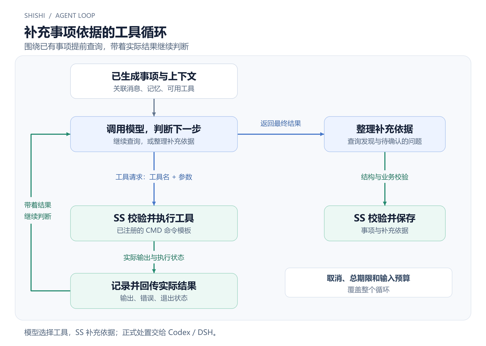

这次，我把拾事做成了一个小 Agent，让它在事项生成后，先通过工具查一查相关数据，为后续判断和处理补充依据。

## 需求背景

比如测试同学问：“这个功能怎么又不行了？”

拾事已经把这条反馈整理成了事项，但问题可能在代码，也可能只是数据或者配置不对。如果能先查一下相关记录，再看看 Apollo 里的配置，等我处理这个事项时，就能少翻几下系统。

这些事当然也能交给 Codex、DSH。不过，为了几个固定查询，就去麻烦一个完整的 Agent，我觉得有点重，也有点烧 token。

所以，我把这些查询做成工具，让大模型直接选工具、填参数，拾事执行后再把结果交给它。通用性肯定比不上成熟的 Agent，但只做这个领域里的几件事，可以把流程收得更小，把成本和效率放在前面考虑。

真正要解决问题时，还是点“AI 一键处置”，交给 Codex、DSH 去干活。这个小 Agent 先把能查的资料准备好。

下面的数据库和 Apollo 查询，都是通过用户自己准备的工具接入。

## Agent 执行循环

这部分参考了 [Claude Code 的工具循环](https://code.claude.com/docs/en/how-claude-code-works)。核心其实很简单：模型返回工具请求，程序执行，把结果放回上下文，再问模型。

```text
当前上下文 = 已生成事项 + 相关资料 + 可用工具

while 未取消，且还有时间和预算:
    回复 = 调用模型(当前上下文, 可用工具)

    if 回复包含最终结果:
        校验并保存事项与补充依据
        break

    调用 = 校验工具名和参数(回复)
    工具结果 = SS执行工具(调用)
    当前上下文 += 本次调用和工具结果
```

这里的 SS 就是拾事。模型只决定下一步要用什么工具，真正执行命令、取得输出的是 SS。



比如先查了一条业务记录，发现还需要核对配置，那就再查配置。结果回到模型以后，它可以继续查，也可以结束，整理这次发现。

我们不用把“先查数据库，再查配置”写死。具体查什么、查几次，由模型根据已有信息决定。不需要工具时，也可以直接返回结果。

循环得到的是补充后的事项和依据。查到了什么、推测了什么、还缺什么，都需要分清楚，不能查到一个配置值，就说问题已经解决了。

## 工具接口设计

另一个受到 Claude Code 启发的地方，是尽量复用命令行。我把这个取舍理解成“CLI Is All You Need”：能用命令完成，就先用命令，简单。

拾事跑在 Windows 上，这里就用了 CMD。比如注册一个示例工具：

```text
python query_record.py --id {{record_id}}
```

先准备好脚本，再填写工具名、用途、参数说明和这条命令模板。模型拿到工具说明后，只需要选中它，给出 `record_id`。SS 从本地取模板，校验参数，再执行命令。模型不能拿一整条新命令替换它。

工具内部怎么连数据库、怎么读 Apollo，由工具自己处理。可以用脚本，也可以用现成的可执行程序，不需要为了接入拾事再做一套专用服务。

参数全部按字符串传，业务类型和校验留给工具。输出统一用 UTF-8，普通文本就可以，不要求脚本再套一层 JSON。SS 会把输出、错误和退出状态一起交回模型。

命令环境和依赖也要自己准备，CMD 的参数引用仍有明确限制，无法可靠传入的值会在执行前被拒绝。

## 多模型后端适配

接下来，把各个模型后端接到这个循环里。

| 接入方式 | 模型怎么请求工具 | 谁执行 |
| --- | --- | --- |
| 兼容 API | 原生结构化工具调用 | SS |
| Codex | 约定格式的结构化文本 | SS |
| DSH | 约定格式的结构化文本 | SS |

这里说的是非一键处置请求。Codex、DSH 在这条链路里作为模型后端，协议差异由适配层处理，后面共用工具执行和结果回传。

所以，只有 API 也能跑完这个循环。换一个模型后端，已经注册的工具还能继续用。

这套工具能力也用于事项分析、生成、修改和归档，沿用各自配置的模型，最后按各自的业务格式返回，不再单独配一个“工具模型”。上下文补查和图片读取，也由 SS 调度。

到一键处置时，Codex、DSH 作为完整的 Agent 接手。它们可以通过 MCP 的通用 `ss_tool` 入口，继续使用拾事里的工具。

## 执行控制与调用记录

执行时，程序会检查工具权限、总时限和取消状态，并记录每次调用：

- 只用用户注册、启用且本次声明的工具。目录在请求开始时固定，每次执行前再检查开关；中途关掉，就不能继续启动。
- 总时限、取消和输入预算覆盖整个循环，续一轮不会重新计时，输出也有大小限制。取消或超时后，回收本次拥有的子进程。
- 先保存调用意图，再执行命令，之后保存结果。相同调用编号不重放，网络失败或结果未知时，也不自动重新执行。
- 每次调用保留工具名、参数、状态和输出，并按实际使用关系关联事项，方便回查依据。

消息和工具输出都只是资料，不能靠里面的一句话打开工具或者扩大权限。工具运行成功，也不代表事项已经处理完成，最终业务结果仍要校验后保存。

## 归档记忆

顺带把归档记忆也改了一下。

[上一篇](https://blog.linhui.fun/posts/shishi-ai-context-engineering/)里，主要依靠归档备注整理经验。现在，修改事项、调整状态、合并、撤销和处理结果这些操作记录，也可以作为来源，不必每次再补一段备注。

不过，操作本身未必说明原因。把某条事项标成“无需处理”，可能只是已经在线下做完了，不能直接记成“以后这类消息都不用管”。归档要结合本批记录判断，引用有效来源，区分一次性例外和长期经验，证据不足就保留原记忆。

这些经验存在用户私有的上下文里。消息分析维护临时记忆，归档维护归档记忆，都可以查看和编辑。提示词、规则和标签仍由用户决定是否修改或采用。
