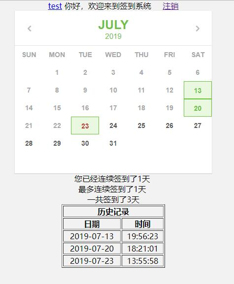
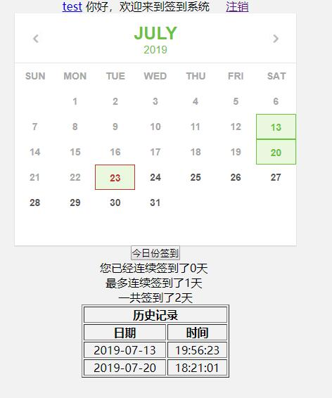

{
  "title": "java web小项目：记录签到系统",
  "date": "2019-07-20T00:00:00+08:00",
  "lastmod": "2026-10-12T00:00:00+08:00",
  "slug": "tencent-2351618",
  "author": "LinHuiG",
  "categories": [
    "Java实践"
  ],
  "tags": [
    "java",
    "web",
    "登录",
    "数据",
    "系统"
  ],
  "draft": false,
  "original_date": "2019-07-20",
  "backfilled_at": "2026-10-12",
  "migration_source": "https://cloud.tencent.com/developer/article/2351618",
  "original_url": "https://blog.linhui.fun/article/11",
  "build": {
    "publishResources": false
  },
  "description": "java web小项目：记录签到系统。旧文归档，原始发表于 2019-07-20。",
  "original_date_text": "2019-07-20",
  "original_sort_key": 20190720,
  "original_year": 2019,
  "date_precision": "day"
}

> **旧文迁移 · 补录说明**
>
> 原始发表：**2019-07-20**；本站迁移：**2026-10-12**。正文与代码按历史版本归档。
>
> [腾讯云原文](https://cloud.tencent.com/developer/article/2351618) · [原个人博客地址](https://blog.linhui.fun/article/11)

在家无聊写了这个小项目，实现了账号注册，登录模块，以及签到模块。

用到了jsp+mysql。

账号注册和登录是直接从上学期jsp课设作业中扒出来的，稍微改了点东西，主要是数据方面的，账户存name + password + regdate + runningdays + maxrunningdays这几个数据。

签到模块实现比较简单，数据为name+signindate。

本来以为一个中午就能搞完，结果前端的东西和一些签到逻辑的细节零零散散一共还是花了几小时（不了解js的后果）。

日历显示是网上随便抄了一份改了改就用了（链接：[https://blog.csdn.net/qq\_22317389/article/details/80349497](<https://blog.csdn.net/qq_22317389/article/details/80349497>)）。

代码在gitee上：[https://gitee.com/linhui\_fun/Check-in\_System](<https://gitee.com/linhui_fun/Check-in_System>)

实例在：[http://jlqd.linhui.fun](<http://jlqd.linhui.fun/>)

效果大概是这样子的。

还没签到是这个样子的

这个系统以后就用来记录起床时间了~
