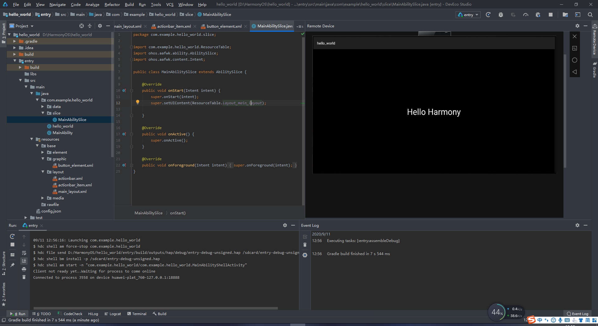

{
  "title": "鸿蒙开发环境以及依赖的安装及HelloWorld编写",
  "date": "2020-09-11T00:00:00+08:00",
  "lastmod": "2026-10-12T00:00:00+08:00",
  "slug": "tencent-2351639",
  "author": "LinHuiG",
  "categories": [
    "环境与运维"
  ],
  "tags": [
    "开源",
    "程序",
    "开发",
    "开发环境",
    "域名"
  ],
  "draft": false,
  "original_date": "2020-09-11",
  "backfilled_at": "2026-10-12",
  "migration_source": "https://cloud.tencent.com/developer/article/2351639",
  "original_url": "https://blog.linhui.fun/article/52",
  "build": {
    "publishResources": false
  },
  "description": "鸿蒙开发环境以及依赖的安装及HelloWorld编写。旧文归档，原始发表于 2020-09-11。"
}

> **旧文迁移 · 补录说明**
>
> 原始发表：**2020-09-11**；本站迁移：**2026-10-12**。原始日期依据腾讯云页尾记录，正文与代码按历史版本归档。
>
> [腾讯云原文](https://cloud.tencent.com/developer/article/2351639) · [原个人博客地址](https://blog.linhui.fun/article/52)

昨天晚上（今天凌晨）睡前刷到鸿蒙2.0开源的消息，貌似放出了开发文档和IDE什么的（总之就是我们可以在上面写代码了），虽然我并不会安卓开发，但是不妨碍我写个HelloWorld呀~~，于是今天就来试试了~

安装IDE，SDK，以及一些乱七八糟的依赖步骤在这：[DevEco Studio下载安装](<https://developer.harmonyos.com/cn/docs/documentation/doc-guides/software_install-0000001053582415>) 

编写HelloWorld的步骤在这：[HarmonyOS的第一个程序](<https://developer.harmonyos.com/cn/docs/documentation/doc-guides/start-first-page-0000000000038014>) 

看上去好像和（印象中的）安卓的开发没啥区别，除了xml里把Android换成ohos~~emmmmmmm，等大佬分析吧，如果是自己开发的话，这样可以兼容安卓的生态好像也不是啥坏事，如果是安卓套壳的话emmmmmmm（但愿不是）~

另外，，不知道为啥下载Gradel什么的默认源还是在国外，还得挂SS下，.....“<http://schemas.huawei.com/res/ohos”这个一开始一直标红，直接访问schemas.huawei.com却发现dns没有这个域名的ip，，然后挂SS下好Gradel后，又正常了...>

一大堆步骤后，总而言之，我跑起来咯~~

