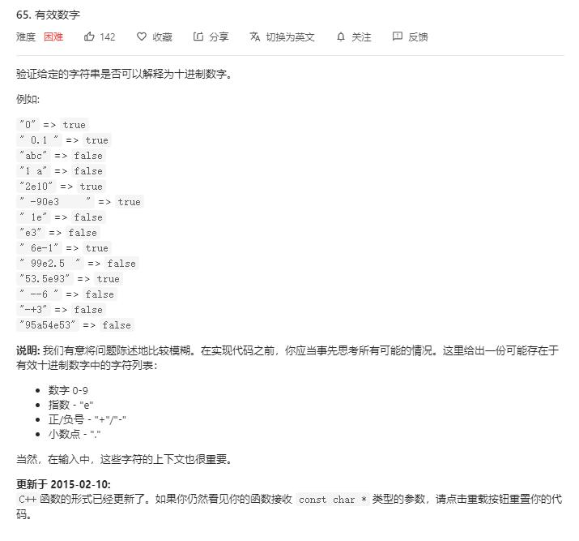
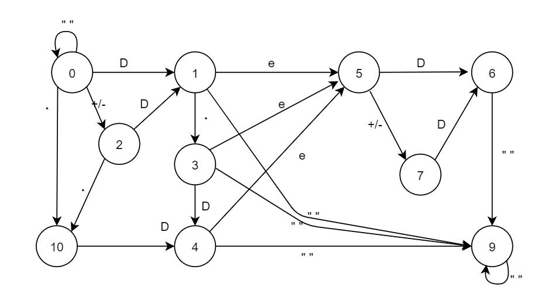
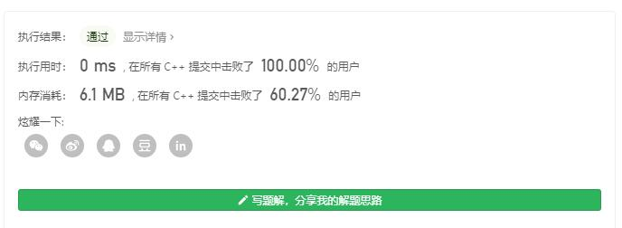

{
  "title": "LeetCode 65：有效数字 DFA自动机解法",
  "date": "2020-08-12T00:00:00+08:00",
  "lastmod": "2026-10-12T00:00:00+08:00",
  "slug": "tencent-2351644",
  "author": "LinHuiG",
  "categories": [
    "算法练习"
  ],
  "tags": [
    "leetcode",
    "编译原理"
  ],
  "draft": false,
  "original_date": "2020-08-12",
  "backfilled_at": "2026-10-12",
  "migration_source": "https://cloud.tencent.com/developer/article/2351644",
  "original_url": "https://blog.linhui.fun/article/49",
  "build": {
    "publishResources": false
  },
  "description": "LeetCode 65：有效数字 DFA自动机解法。旧文归档，原始发表于 2020-08-12。"
}

> **旧文迁移 · 补录说明**
>
> 原始发表：**2020-08-12**；本站迁移：**2026-10-12**。原始日期依据腾讯云页尾记录，正文与代码按历史版本归档。
>
> [腾讯云原文](https://cloud.tencent.com/developer/article/2351644) · [原个人博客地址](https://blog.linhui.fun/article/49)

今天刷了一下LeetCode，发现了一道很有感觉的题目，题面如下：



看到这题的第一反应就是，编译原理里学到的自动机！！！

然后我按照记忆里残留的编译原理的知识，开始画图，，，然后wa了。。。

这道坑爹的题目条件居然要自己摸索！！！！然后就开始了痛苦的修bug之路.....（**需求都不好好提，这样的甲方还是刷上面包糠带到河边吧**）

最后，我弄出了这样的DFA图



其中，1 3 4 6 9 是可接受状态，0是初始状态~

然后就快乐的跑起来咯~

D是指数字，这个可以先转换一下再跑DFA，最后跑出了0ms的效果，也有可能LeetCode日常抽风~~



代码放这咯~

```cpp
#include <string>
#include <vector>
#include <algorithm>
#include <stack>
#include <set>
#include <map>
#include <iostream>
#define mn 20
using namespace std;

class Solution {
public:
    int zt[mn][mn];
    string myinit(string s)
    {
        for (int i = 0; i < mn; i++)
            for (int j = 0; j < mn; j++)
                zt[i][j] = -1;
        zt[0][0] = 2;   zt[0][5] = 7;
        zt[1][0] = 1;   zt[1][2] = 1;   zt[1][3] = 4;   zt[1][5] = 6;   zt[1][7] = 6;   zt[1][10] = 4; zt[1][11] = 9;
        zt[2][1] = 5;   zt[2][3] = 5;   zt[2][4] = 5;
        zt[3][0] = 10;  zt[3][1] = 3;   zt[3][2] = 10;
        zt[4][0] = 0;   zt[4][1] = 9;   zt[4][3] = 9;   zt[4][4] = 9;   zt[4][6] = 9;   zt[4][9] = 9;
        string str = "";
        for (char c : s)
        {
            if (c >= '0' && c <= '9')
            {
                if (str.size() && str.back() == 'd') continue;
                else str.push_back('d');
            }
            else str.push_back(c);
        }
        return str;
    }
    int zh(char c)
    {
        if (c == '-' || c == '+')return 0;
        if (c == 'd')return 1;
        if (c == 'e')return 2;
        if (c == '.')return 3;
        if (c == ' ' || c == '\t' || c == '\n') return 4;
        return 5;
    }
    bool isNumber(string s) {
        s = myinit(s);
        int now = 0;
        for (char c : s)
        {
            now = zt[zh(c)][now];
            if (now == -1)return 0;
        }
        return (now == 1 || now == 3 || now == 4 || now == 6 || now == 9);
    }
};
```
