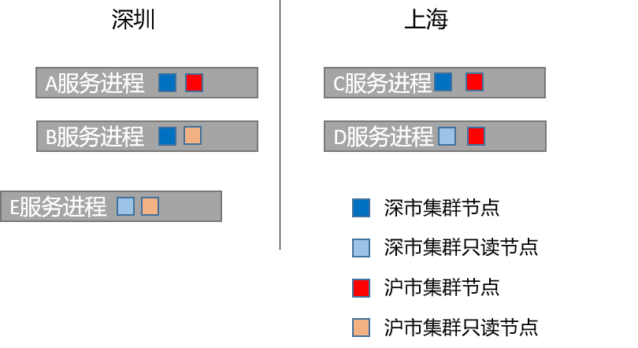

{
  "title": "raft集群实战案例：两地四节点",
  "date": "2023-07-31T00:00:00+08:00",
  "lastmod": "2026-10-12T00:00:00+08:00",
  "slug": "tencent-2351647",
  "author": "LinHuiG",
  "categories": [
    "分布式与网络"
  ],
  "tags": [
    "raft",
    "服务",
    "集群",
    "日志",
    "数据"
  ],
  "draft": false,
  "original_date": "2023-07-31",
  "backfilled_at": "2026-10-12",
  "migration_source": "https://cloud.tencent.com/developer/article/2351647",
  "original_url": "https://blog.linhui.fun/article/71",
  "build": {
    "publishResources": false
  },
  "description": "raft集群实战案例：两地四节点。旧文归档，原始发表于 2023-07-31。",
  "original_date_text": "2023-07-31",
  "original_sort_key": 20230731,
  "original_year": 2023,
  "date_precision": "day"
}

> **旧文迁移 · 补录说明**
>
> 原始发表：**2023-07-31**；本站迁移：**2026-10-12**。正文与代码按历史版本归档。
>
> [腾讯云原文](https://cloud.tencent.com/developer/article/2351647) · [原个人博客地址](https://blog.linhui.fun/article/71)

raft作为一个强一致性的集群共识算法，可以保证当集群多数节点存活时服务可用，但只能有一个领导者，有比较大的局限性。  
 若是使用同集群多实例方案，所有实例同生共死，当集群非多数节点存活时，所有实例均无法对外提供服务。

本方案提出两地四节点方案，使用在金融交易场景，在深圳与上海机房各自部署两个节点。

  
 方案：  
     1. 我们需要在深圳与上海各放置两台服务器，设深圳两台服务器分别为A、B，上海两台服务器分别为C、D  
     2. 我们将A、B、C作为一个raft集群实例的节点（深市group），D是这个集群的只读节点，并且将C的优先级设置为0，这样就可以保证在服务可用的情况下这个集群主节点一定在深市。  
     3. 我们将C、D、A作为另一个raft集群实例的节点（沪市group），B是这个集群的只读节点，并且将A的优先级设置为0，这样就可以保证在服务可用的情况下这个集群主节点一定在沪市。  
     4. 当深市集群可用时，A、B、C节点至少存活两个，也就意味着深市一定存活一个，由于深市节点优先级配置较高，所以可以保证主节点一定在深市。沪市同理  
     5. 当任意一个节点宕机，两个集群实例存活节点数量一定不小于2，集群均可存活  
     6. 当深市或沪市整个机房宕机，则本机房的集群失活，但另一个机房的集群可正常存活并对外提供服务，满足异地机房灾备  
     7. 当三个节点宕机，服务不可用  
     8. 特殊：由于A、B节点特殊（两个集群实例都包含），若A、B同时宕机，则服务不可用；若A、B存活而C、D宕机，两个集群均存活可用  
     9. 延迟：正常情况下，A和C分别为深沪市集群的主节点，用户请求打入A/C后，均可在同机房的B/D节点返回后commit并打入交易所，异地机房延迟不影响交易延迟，满足金融低延迟需求；  
     10. 注意：同集群实例内的日志有序，集群实例之间的日志不保序，即深市集群提交的日志与沪市集群提交的日志两者之间可能存在乱序，业务上需要考虑到这种情况。  
     11. 注意：两个集群实例并不意味着在同一个物理节点上部署两个进程，而且同一个进程内存在两个抽象的raft节点对象，这也才能达到异地数据共享的目的（否则需要额外手段）  
     12. 由于整个服务是依赖raft日志文件作为数据持久化手段，外部程序需要获取数据需要读取服务内存或者解析raft文件，耦合性较高，所以若有需要，可以另起一个E节点（数据落地节点），作为两个集群的只读节点，业务执行修改内存数据的时候，同时写入DB。外部服务需要读取数据时可直接读取DB。
