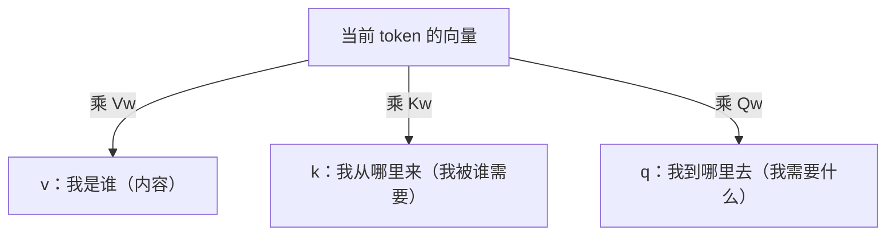
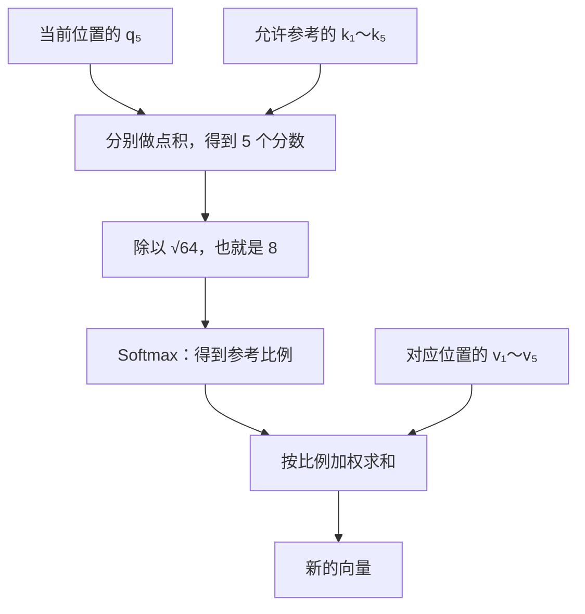
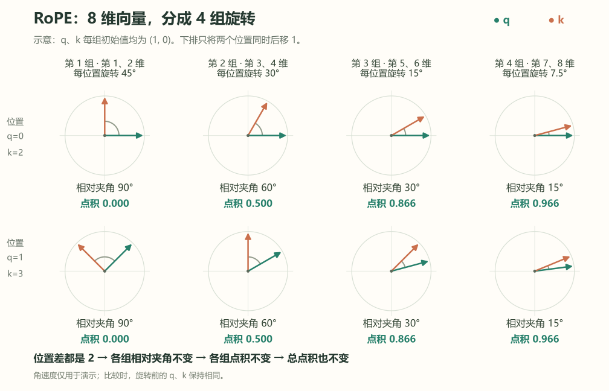
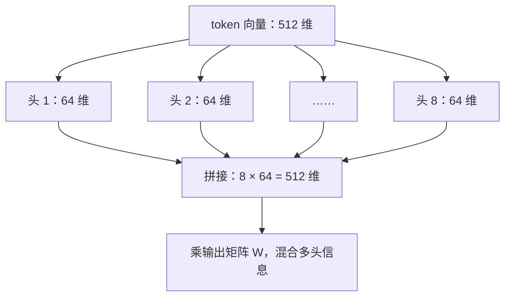
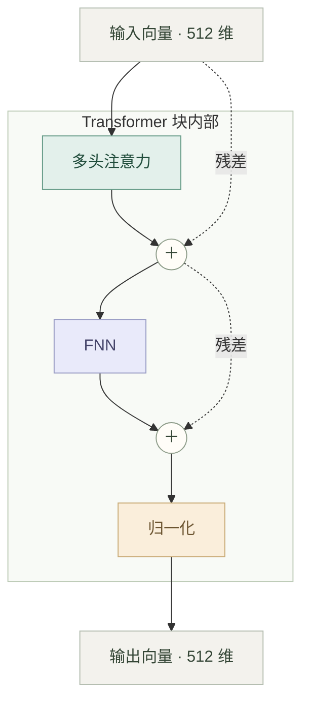
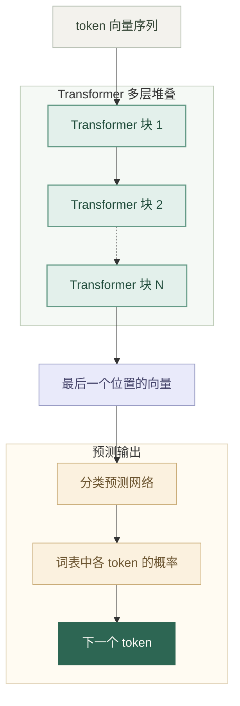
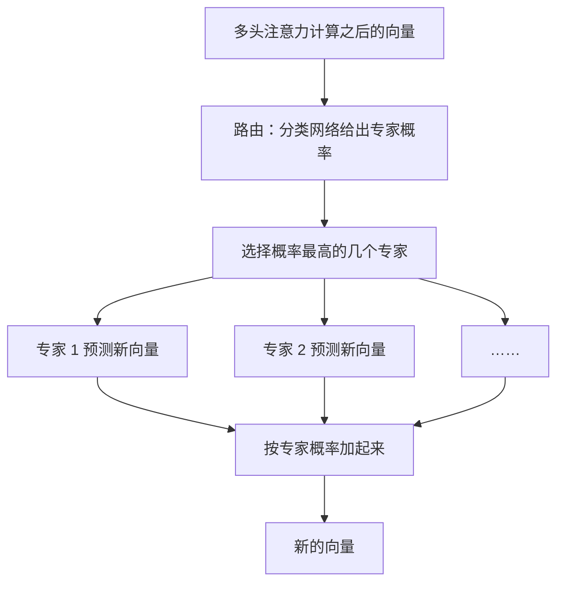

{
  "title": "Transformer 解析",
  "slug": "transformer-notes",
  "author": "LinHuiG",
  "draft": false,
  "date": "2026-10-12T00:00:00+08:00",
  "lastmod": "2026-10-12T00:00:00+08:00",
  "original_date_text": "2026-10-12",
  "original_sort_key": 20261012,
  "original_year": 2026,
  "date_precision": "day",
  "categories": [
    "技术实践"
  ],
  "tags": [
    "Transformer",
    "注意力机制",
    "学习笔记"
  ],
  "description": "我前几年完全无法理解的多头注意力模型，今天能理解了！从分词、Embedding、qkv 到 RoPE、多头注意力和 MoE，记下这次理解的过程。"
}

今天发现，我前几年完全无法理解的多头注意力模型，被 Astra 大人拆碎喂过来后，我能理解了！

## 词表

首先，我们需要针对语料拆个词表出来。比如 BPE，反复寻找经常相邻出现的两个片段，把它们合成一个新片段。

简化例子：

```text
订单成交
订单取消
查询订单
订单过期
```

先按单字拆：

```text
订 | 单 | 成 | 交
订 | 单 | 取 | 消
查 | 询 | 订 | 单
订 | 单 | 过 | 期
```

然后算法会计算得到，“订单”连在一起 4 次，那么就把“订单”也加入表里，拆成：

```text
订单 | 成 | 交
订单 | 取 | 消
查 | 询 | 订单
订单 | 过 | 期
```

如果还有别的语料，可能还会合并出“成交”“取消”“过期”“查询”等片段，直到达到设定的条件为止。

然后我们的输入，就可以这么按词表拆分成一个个 token。

## Embedding

接下来，这些 token（tokenId）进入 Transformer 的 Embedding 层，从一张可训练的向量表中取出对应行，得到向量。

这个 tokenId 和对应的向量，是一一对应的映射。经过这一层，一句话被分词为 token 列表，然后变成 token 向量列表。

## q、k、v

然后就正式开始了 Transformer 循环。在第一次循环里，每个 token 都要乘以三个权重矩阵 `Qw`、`Kw`、`Vw`，得到向量 q、k、v。

注意，这一步和其他 token 没有关系，所以可以并行计算。

这三个向量还挺哲学的：

> v：我是谁（内容）  
> k：我从哪里来（我被谁需要）  
> q：我到哪里去（我需要什么）



## 注意力计算

然后再把 q、k、v 一起计算注意力，那个公式简单说就是：

1. 当前位置的 q 分别与每个允许参考位置的 k 做点积。比如我们一共有 10 个 token，正在计算第 5 个时，我们要把 q₅ 和前 5 个 token 的 k 进行点积计算。
2. 于是对每个 token 都打了一个分数，共有 5 个分数。这个分数还得除以根号 d，也就是 q、k、v 维度数的根号。还是拿 512 维、8 头注意力举例，这里的 q、k、v 维度是 64，所以我们要除以 √64，也就是 8。
3. 然后对这一组分数做 Softmax，得到参考比例，按比例对各个位置对应的 v 加权计算，就得到了新的向量。



## 位置编码与 RoPE

这里其实还缺失了一点，就是 token 的位置信息我们没提到。

在最原版的 Transformer 里，位置信息是直接在 token 向量上加个固定向量，然后丢进 Transformer 循环的。

但在 RoPE 里，是在 q、k、v 计算完成后，对 q、k 进行旋转来完成位置信息编码的。

假如 q 或者 k 向量为 `(1, 0)`，那么不同的位置会将它旋转不同角度：

| 位置 | 旋转角度 | 旋转后的向量 |
| --- | --- | --- |
| 0 | 0° | `(1, 0)` |
| 1 | 90°（这个度数可配置） | `(0, 1)` |
| 2 | 90° × 2 | `(-1, 0)` |
| … | … | … |

这一步真的是太神奇了。我们都知道，q 要乘以其他 token 的 k。

这就意味着，保持旋转前的 q、k 不变，只把它们的位置同时向后移动相同距离，旋转后的 q、k 乘积都不会变。比如两个向量原来是 `(1, 0)`、`(1, 0)`：

| 所在位置 | 旋转后的两个向量 | 乘积 |
| --- | --- | --- |
| 0、2 | `(1, 0)`、`(-1, 0)` | -1 |
| 1、3 | `(0, 1)`、`(0, -1)` | -1 |
| … | … | … |

只考虑相对位置，不考虑绝对位置。

但平面就 360 度，而且实际 token 维度可能为 512 甚至更多，这么高维度怎么转呢？

解法太精妙了：两个维度一组，分别旋转，且旋转速度不同。这样就可以保留相对位置乘积参数不变的同时，让 512 维度都参与进来。多种旋转速度结合起来，可以提供更多的位置信息空间。

只要这个位置信息没有丢失，那么模型训练过程中，自然会利用到这个信息，啧。



## 多头注意力

然后 q、k、v 再用那个注意力公式，就得到了和 v 一样长度的新向量。其他 token 也一样并行计算，就得到了一组新向量。

以上是单头注意力。我们只要把这个计算用新的一组权重算 n 次，就得到 n 头注意力。

我们还是假设 token 是 512 维，然后 q、k、v 是 64 维的（调整权重矩阵即可得到不同维度）。我们的单头注意力就是 64 维，只要算 8 次得到 8 头注意力，然后把这 8 头连接，即可得到 `8 × 64 = 512` 维的新向量。

然后这 512 维度，再乘一个输出矩阵 W，让这多头信息混合起来。然后再残差处理，然后进行 FNN，再残差、归一化等等，这些传统神经网络操作一波，最后输出 512 维的新向量。





## 预测下一个 token

接下来就是下一组循环，把这一批 512 维的向量再输入到下一个 Transformer 里，然后再下一组，再下一组。

到最后一组循环，我们取最后一个向量。这时候这个向量已经和前面的向量产生了足够多的纠缠了（我为什么会用纠缠这个词，人的意识不会来自量子层面的纠缠吧？其实原理和这个差不多？瞎猜的。）。

我们用这个向量来预测下一个向量，把它丢进一个分类预测网络层里。这个层的输出和词表大小一样，每个维度代表每一个 token 的概率。我们一般取最大的，或者再 Softmax 一下，然后按概率随机一下之类的，得到下一个 token。



## MoE

然后还有 MoE 专家模型，也很简单。

在多头注意力计算之后的传统神经网络里，我们可以准备多套权重（多个专家），每次进行一次路由。路由规则是一层分类网络，参与训练，输出一组后面应该激活的专家概率，选择最高的那几个专家即可。

然后这些专家分别预测新的向量，按专家概率把它们加起来即可。



啧。
